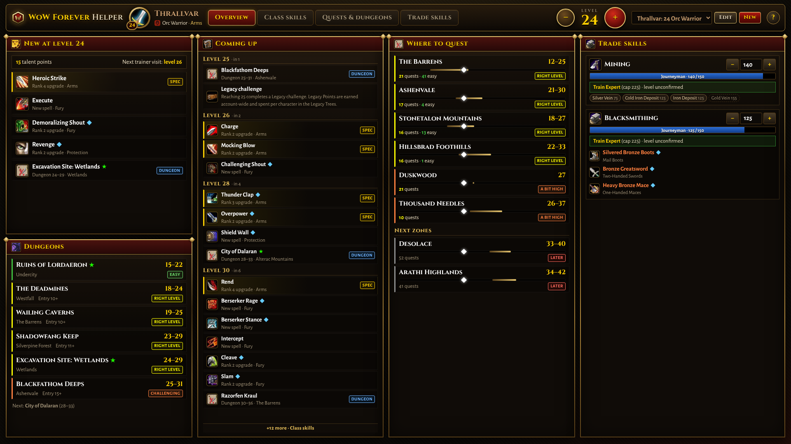

# WoW Forever Helper

[](https://github.com/draindrain/wow-forever-helper/actions/workflows/deploy.yml)

**Open it: [draindrain.github.io/wow-forever-helper](https://draindrain.github.io/wow-forever-helper/)**

A second-screen leveling cheat sheet for **World of Warcraft: Forever**. Create your character (race, class,
spec and trade skills), bump the level each time you ding, and the page shows what matters at that level.



It's built to sit on a second monitor while you play: on a 1080p screen everything fits without scrolling.
Every list shows as many rows as fit and ends in "+N more" instead of running off the screen. Four tabs hold
the details:

- **Overview** (the default) packs in as much as fits: what's new at your trainer this level, what unlocks
  over the next levels, where to quest, dungeons in range, and your trade skills with their best skill-ups.
- **Class skills**: new and upcoming trainer spells, your spellbook with one column per talent tree (your
  spec's first), plus racials, talent milestones (dual spec at 40, spec talents) and gear unlocks.
- **Quests & dungeons**: zones for your faction around your level with how many quests sit at your level, the
  herbs and veins you can gather there, and the next zones coming up; dungeons in range with entry level and
  bosses; later dungeons; battlegrounds and raids.
- **Trade skills**: one column per profession. Track your skill, see when the next rank unlocks, the recipes
  that give skill-ups now and what unlocks soon. Mining and Herbalism also list the nodes you can gather and
  where; Skinning shows the highest level you can skin.

Click any zone or dungeon for its quests. A zone opens with its map: every quest giver is pinned as a `!`
(pick up) or `?` (turn in) coloured by difficulty for you, and hovering a quest lights up its pins. Each quest
shows its level, objective, where to pick it up and hand it in (with coordinates), its rewards (XP, money,
reputation and items) and, for chains, every step in order. Dungeons and raids list their quests plus any key
or attunement chain; on the Classic dungeons Forever keeps, the map shows a numbered pin for each boss.
Hover a spell, talent, racial, recipe or reward item for its tooltip.

Several characters can be saved; they live in your browser's local storage. Keyboard: `+` / `-` change
level, `1`–`4` switch tabs. On windows smaller than about 1100×600 (phones, small laptops) the page falls back
to a normal scrolling layout.

## Data

Everything is WoW Forever data from the beta client (build `1.60.1.70532`), not Classic:

| What | Source |
| --- | --- |
| Class spells, ranks and levels; racials; recipes; dungeon entry levels | Read from the Forever client by [wowforevertalents.com](https://wowforevertalents.com/) |
| Race/class combinations; dungeon bosses | Forever client tables via [wago.tools](https://wago.tools/) |
| Zone quest levels and gathering nodes | [Wowhead's Forever database](https://www.wowhead.com/forever) |
| Quests: givers, coordinates, chains and rewards; zone maps; item tooltips | [Wowhead's Forever database](https://www.wowhead.com/forever) (quest pages, map images and its tooltip API) |
| Boss positions on dungeon maps | Classic's creature spawns from [CMaNGOS classic-db](https://github.com/cmangos/classic-db), fitted onto Wowhead's map images |
| Dungeon level ranges, launch raids, dual spec and other milestones | Blizzard announcements, via [warcraft.wiki.gg](https://warcraft.wiki.gg/wiki/World_of_Warcraft:_Forever) |

Caveats:

- The beta stopped at level 30. Spells and dungeons above 30 come from the client data, so expect changes at
  launch. The site flags this when you go past 30.
- Zone ranges are the middle 80% of a zone's quest levels for your faction. Riverglades and Mount Hyjal have too
  few catalogued quests so far, so they use Wowhead's zone range and Blizzard's level 60.
- Keys and attunements (Onyxia's Lair, Scholomance, Blackrock Depths, Maraudon) follow Classic and are listed
  only when their quests exist in Forever's data.
- Boss pins assume Forever's Classic dungeons are unchanged. Wowhead's map images aren't the game's map
  textures, so each one is matched to Classic's spawn positions by fitting and was checked by eye. Fourteen
  dungeons line up; Deadmines, Shadowfang Keep, Scarlet Monastery and Zul'Farrak don't, Lower Blackrock Spire
  has no map, and Forever's new dungeons have no Classic data, so those show their boss list only. Bosses that
  only appear through an event (Timmy the Cruel, Kirtonos) have no fixed spot.
- Trainers keep their requirements on the server. Profession rank levels other than Journeyman (10), the
  Apprentice Riding level, and the skill for trainer-taught recipes are Classic values or estimates. The site
  marks them as unconfirmed.

## Development

Requires Node 22.12+.

```sh
npm install
npm run dev        # http://localhost:5173
npm run build      # type-check and build to dist/
npm run format     # Prettier for src/ (CI runs format:check)
```

The app is Vite + React + TypeScript. Generated data lives in `src/data/generated/` and is committed, so
building the site never touches the network.

### Refreshing the data

When a new Forever build lands (or after launch):

1. Bump `WAGO_BUILD` in `scripts/sources.mjs` if the client build changed.
2. `npm run data:fetch -- --force` re-downloads everything into `data-raw/` (git-ignored). Wowhead pages are
   rendered in headless Chrome through `playwright-core`; set `CHROMIUM_PATH` if Chrome/Chromium isn't found.
   Add `--only=wft,wago,wowhead,quests,items` to fetch a subset. Without `--force`, files already downloaded
   are kept. `quests` renders every quest page in the zone and dungeon lists (about 3,000; it takes an hour or
   so and restarts its browser whenever Wowhead's bot check starts timing out), so run it after `wowhead`;
   `items` then fetches tooltips for reward and crafted items; `cmangos` downloads Classic's spawn database for
   boss positions.
3. `npm run data:build` turns `data-raw/` into `src/data/generated/`. (`npm run data` runs both steps.)
4. Only if Wowhead's dungeon map images change: `node scripts/fit-dungeon-maps.mjs` refits them into
   `scripts/dungeon-maps.json` and writes previews to `data-raw/maps/`. Check each preview by eye before listing
   its map in `PINNED_MAPS` (`scripts/curated.mjs`).
5. Facts that aren't in any machine-readable source (dungeon ranges, milestones, profession rank levels, zone
   notes) are in `scripts/curated.mjs`, each with its source. Update them as Blizzard confirms things.

### Weekly updates with the research agent

`npm run data:update` (`scripts/update-agent.mjs`) does the refresh above, has a Claude agent review it, and
opens a pull request:

- It bumps `WAGO_BUILD` when wago.tools has a newer Forever client build, re-downloads the listing pages
  (wowforevertalents, wago tables, Wowhead zones), fetches only quest pages and item tooltips that are new, and
  rebuilds the data.
- It diffs the generated data before and after: spells, racials, recipes, zones, dungeons, raids, quests,
  milestones and profession ranks that were added, removed or changed.
- The agent is [Claude Code](https://code.claude.com) running Claude Sonnet on your Claude subscription. It
  reads that diff and `scripts/curated.mjs`, searches the web and reads Blizzard's news and forums,
  warcraft.wiki.gg, Wowhead and a few other sites for Forever announcements, and fixes curated facts that a page
  it read confirms. It may only search, read the repository and edit `scripts/curated.mjs`: other sites, files
  and commands are blocked, the file must still load afterwards, and it's told to leave the boss-pin settings
  alone.
- It writes `data-raw/update-report.md`: the agent's summary, the data changes, the agent's edits, and anything
  that needs a person (suspected scraping problems, unconfirmed news).
- When anything changed, it builds the site, commits the changes to a new `data-update/<date>` branch, pushes
  it and opens a pull request with the report as its description, so you review and merge it like any other
  change. Nothing reaches the site before that. If nothing changed, there's no pull request.

`.github/workflows/data-update.yml` runs it every Monday once it's turned on, or whenever you start it from the
**Actions** tab (**Data update → Run workflow**). Setup:

1. Install [Claude Code](https://code.claude.com/docs/en/setup) on your computer, log in with your Claude Pro
   or Max account, and run `claude setup-token`. It prints a token that lets Claude Code use your subscription
   for a year.
2. Add that token as a repository secret named **`CLAUDE_CODE_OAUTH_TOKEN`**: **Settings → Secrets and
   variables → Actions → New repository secret**. Don't commit it to a file.
3. In **Settings → Actions → General**, under *Workflow permissions*, tick **Allow GitHub Actions to create and
   approve pull requests** so the workflow can open its pull request.
4. Start a run by hand from the **Actions** tab to check that it works.
5. Turn on the weekly run: under **Settings → Secrets and variables → Actions → Variables**, add a repository
   variable named **`DATA_UPDATE_ENABLED`** with the value `true`. Until then the Monday run is skipped. To turn
   it off again, delete the variable or set it to `false`.

The agent's runs count against your subscription's usage limits, the same as using Claude yourself; a weekly
run takes a few minutes of Claude Sonnet. Renew the secret when the token expires after a year.

To run it locally, install Claude Code and log in, check out an up-to-date `main` and run `npm run data:update`.
Opening the pull request needs a GitHub login: `gh auth login`, or a `GITHUB_TOKEN=...` line in a `.env` file in
the repository root (git-ignored; a token that can push and open pull requests on this repository). Add
`-- --no-pr` to leave the changes in your working tree instead, `-- --no-agent` to skip the agent, or
`-- --skip-fetch` to rerun the agent on the data you already have. Changes to quests that already exist aren't
re-fetched weekly; run `npm run data:fetch -- --only=quests --force` now and then for a full refresh.

## Deployment

`.github/workflows/deploy.yml` builds the site and deploys it to GitHub Pages on every push to `main`
(pull requests only build). The build sets the canonical URL, social preview tags and `sitemap.xml` from the
Pages address, so a custom domain picks them up on its own. One-time setup: in the repository's **Settings → Pages**, set **Source** to
**GitHub Actions**.

---

Fan-made and unofficial. World of Warcraft is a trademark of Blizzard Entertainment, Inc. Icons are served from
Wowhead's CDN.
